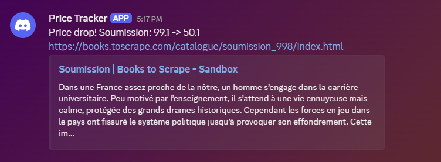
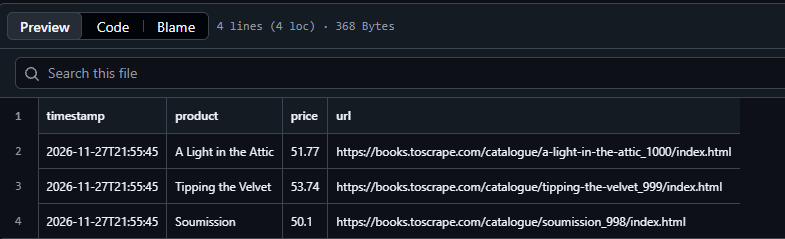
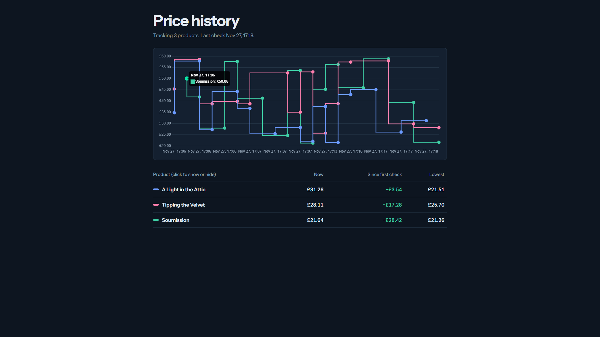

# Price Tracker

Tracks product prices every day and sends a Discord alert the moment one drops. No manual checking, no spreadsheets to update.



## What it does

Checking prices by hand is slow and easy to forget. This tool does it for you:

- Visits each product page on a list you control
- Records every price with a timestamp, building a full price history
- Sends a Discord message when a price goes down
- Runs automatically once a day in the cloud, so your computer doesn't need to be on

## Sample output

Every run adds a row per product to [`prices.csv`](prices.csv):



And also appears on [`index.html`](index.html):


Because each row is timestamped, the file doubles as a price history you can open in Excel or Google Sheets, or chart over time.

## How it works

1. A scheduled GitHub Actions workflow starts every day at 12:00 UTC.
2. The Python script downloads each product page and reads the current price.
3. It compares the new price to the last saved one.
4. If the price dropped, it posts an alert to a Discord channel through a webhook.
5. The updated `prices.csv` is committed back to this repo, so the history is saved and visible.

## Run it yourself

**Requirements:** Python 3.14 (earlier recent versions should also work).

```bash
git clone https://github.com/YOUR-USERNAME/Price-Tracker.git
cd Price-Tracker
pip install -r requirements.txt
python tracker.py
```

To get alerts, create a [Discord webhook](https://support.discord.com/hc/en-us/articles/228383668) and set it as an environment variable before running:

```bash
# Mac/Linux
export DISCORD_WEBHOOK="your-webhook-url"

# Windows (PowerShell)
$env:DISCORD_WEBHOOK="your-webhook-url"
```

Without a webhook, the script still works and prints alerts to the terminal instead.

**To run it in the cloud:** fork this repo, add your webhook URL as a repository secret named `DISCORD_WEBHOOK` (Settings, Secrets and variables, Actions), and enable the workflow from the Actions tab.

## Tracking your own products

The demo tracks a few books on [books.toscrape.com](https://books.toscrape.com), a site built for scraping practice. To track other products, edit the `urls` list in `tracker.py` and adjust the price selector to match the new site's HTML. Always check a site's terms of service and `robots.txt` before scraping it.

## Built with

- Python
- `requests` and `BeautifulSoup` for fetching and parsing pages
- GitHub Actions for scheduling
- Discord webhooks for alerts

## Ideas for extending it

- Set a target price per product and only alert when it is reached
- Add email or Telegram alerts
- Support more stores
- Chart price history on a small web page
